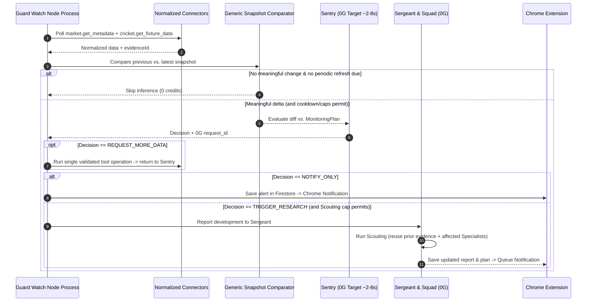

# Overwatch: Implementation Plan & Architecture Reference

**Companion Document:** [`WHITEPAPER.md`](./WHITEPAPER.md)

**Version:** 4.3 (Frozen Baseline)

**Date:** November 4, 2026

**Target Stack:** Next.js 16 + Firebase Firestore + 0G Compute (`0gm-1.0-35b-a3b`) + Chrome Extension (Manifest V3)

> **DIRECTIVE FOR AI CODING AGENTS:**  
> **Overwatch** is an AI-powered prediction-market research and continuous-monitoring product—**not** a prediction-market protocol or Chainlink CRE oracle demo. Do not modify Solidity contracts, deploy Anvil, configure Chainlink CRE workflows, or introduce SQLite/Redis alongside the existing Firestore setup. Module-specific instruction files will be provided before implementing each phase.

---

## 1. Existing Repository Assessment & Infrastructure Reuse

| Classification | Repository Path / Component | Engineering Decision |
|---|---|---|
| **1. Reused Existing Infrastructure** | `frontend/` (Next.js `16.2.6`, React `19.2.6`, Tailwind CSS `4`) & `frontend/src/lib/firebase.ts` (`firebase` `12.4.0` Firestore `db` client). | **Reuse directly.** Host the demo market pages, Overwatch backend API routes (`/api/*`), and **Firestore** persistence inside `frontend/`. Verify whether the client SDK in `firebase.ts` suffices for server routes/workers or add `firebase-admin` for trusted backend and worker operations if needed. Do not add SQLite or Redis. |
| **2. Small Modifications to Existing Code** | `frontend/src/app/page.tsx` (currently lists settled CRE documents from Firestore `demo` collection). | **Repurpose into the minimal mock market UI.** Display seeded demo markets and add `/markets/[marketId]` with clean URLs (e.g., `/markets/ind-nz-over-15`) and optional DOM fallback attributes. |
| **3. New Overwatch Components** | `frontend/src/app/api/*`, `frontend/src/lib/overwatch/*`, `frontend/src/worker/guard-watch.ts`, and `extension/` (Chrome MV3). | **Build for MVP.** Implement wallet challenge auth, encrypted 0G key vault, `InferenceProvider` (`ZeroGInferenceProvider` + dev-only `MockInferenceProvider`), normalized Provider Connectors (`cricket.get_fixture_data`, safe `web.*`, `market.*`), **Sergeant** + 3-Specialist **Squad** (`Data`, `Intelligence`, `Contrarian`) with `evidenceId` traceability, a separate persistent **Guard Watch** Node process + **Sentry**, and the Chrome Side Panel extension. |
| **4. Removed / Deferred Functionality** | `contracts/` (`SimpleMarket.sol`) & `cre-workflow/` (Chainlink CRE + Gemini settlement). | **Remove from MVP scope.** Leave untouched. Do not build smart contracts, Anvil deployments, wagering/order books, Quick Recon mode, Brier scoring, 0G Storage, social sentiment, or complex billing dashboards. |

---

## 2. Proposed High-Level Folder Structure

```text
cre-gcp-prediction-market-demo/
├── contracts/                        # [IGNORED / OUT OF SCOPE] Inherited Solidity contracts
├── cre-workflow/                     # [IGNORED / OUT OF SCOPE] Inherited CRE settlement workflow
├── frontend/                         # [REUSED & EXTENDED] Next.js 16 App + Overwatch Backend + Firestore
│   ├── scripts/
│   │   └── phase0-verify-tools-and-0g.ts   # Phase 0 spike: Sportmonks nested includes, web search & 0G/mock check
│   └── src/
│       ├── app/
│       │   ├── page.tsx                    # [MODIFIED] Demo market directory
│       │   ├── markets/[marketId]/page.tsx # [NEW] Minimal mock market page (URL-identifiable)
│       │   └── api/                        # [NEW] Overwatch Backend REST/SSE Routes
│       │       ├── auth/                   # POST /challenge, POST /verify (wallet session auth)
│       │       ├── 0g/credentials/         # GET status, POST link sk-/mk-, DELETE revoke
│       │       ├── markets/[marketId]/     # GET normalized market metadata (from seeded JSON or Firestore)
│       │       ├── recon/                  # POST run Recon (Sergeant + 3-Specialist Squad)
│       │       ├── watch/                  # GET list, POST track, PATCH pause/resume, DELETE
│       │       └── notifications/          # GET pending alerts for Chrome extension, POST ack
│       ├── lib/
│       │   ├── firebase.ts                 # [EXISTING] Firestore client (add firebase-admin server helper if needed)
│       │   ├── auth/                       # Session verification & AES-256-GCM 0G key encryption
│       │   ├── inference/                  # InferenceProvider interface: ZeroGInferenceProvider + MockInferenceProvider
│       │   ├── connectors/                 # Generic provider HTTP client, typed operations & normalizers
│       │   │   ├── types.ts                # Shared internal models: Match, Innings, Over, Delivery, Player, Team
│       │   │   ├── cricketSportmonks.ts    # cricket.get_fixture_data wrapper + nested include validator & normalizer
│       │   │   ├── webTools.ts             # web.search & web.fetch_page (with URL/SSRF blocklist & untrusted-content wrapper)
│       │   │   └── registry.ts             # Validates & executes typed tool operations, assigning evidenceIds
│       │   ├── agents/                     # Sergeant, Squad (Data, Intelligence, Contrarian) & Sentry runners
│       │   └── watch/                      # Generic Snapshot Comparator, cooldowns & inference limits
│       └── worker/
│           └── guard-watch.ts              # Separate persistent Node process for background monitoring
└── extension/                        # [NEW] Overwatch Chrome Extension (Manifest V3)
    ├── manifest.json
    └── src/
        ├── adapters/                       # URL-first DemoMarketAdapter (DOM fallback) & Polymarket stub
        ├── background/service-worker.ts    # Side panel behavior, chrome.alarms & chrome.notifications
        ├── content/index.ts                # Optional DOM fallback extractor
        └── sidepanel/                      # React UI (Recon report, Evidence sources, Guard Watch, 0G setup)
```

---

## 3. URL-First Market Detection & Minimal Mock Market Harness

### A. URL-First Identification Flow (DOM as Optional Fallback)

1. Extension reads the active tab URL (e.g., `http://localhost:3000/markets/ind-nz-over-15`).
2. Browser platform adapter extracts `{ platform: "demo", marketId: "ind-nz-over-15" }` directly from the URL path (invoking the content script for DOM extraction only if a URL lacks a usable ID).
3. Extension sends `{ platform, marketId }` to `GET /api/markets/ind-nz-over-15`.
4. Backend retrieves the market record from a seeded JSON configuration (or Firestore), normalizes it into canonical market metadata (including the pre-discovered Sportmonks `fixtureId`), and passes it to the **Sergeant** when **Recon** is triggered.

### B. Market Horizon & Demonstration Cricket Markets

With an estimated Full Recon target of **30–90 seconds** (treated as an engineering target to benchmark, not a fixed guarantee), demo markets are designed for **15–30+ minute horizons** (e.g., *"Will India score 35 or more runs across Overs 11–15?"*) or pre-over horizons where Recon runs **before** Target Over #15 begins (*"Will India score 8 or more runs in Over #15?"*) and **Guard Watch + Sentry** monitor the live deliveries.

- **Unambiguous Resolution Rules:** Metadata defines the pre-seeded Sportmonks `fixtureId` (Nov 7, 2026 India vs. New Zealand ODI), Innings, Batting Team, target over(s), inclusion of all batting team extras (wides, no-balls, byes, leg-byes, penalties), run threshold, and void/inconclusive handling if the innings ends early or the deadline expires.
- **Data Integrity Boundary:** Market odds/listings may be simulated (`DEMO MARKET DATA`), while **all cricket scores, deliveries, wickets, and web findings use genuine external data.**

---

## 4. Core Components, API Interfaces, and Essential Data Models

### A. Core Component Responsibilities

| Component | Name | Responsibility |
|---|---|---|
| **Chrome Extension (MV3)** | **Overwatch** | Extracts `{ platform, marketId }` from the active tab URL, renders Recon reports and inspectable source references in the Side Panel, manages tracking, and fires Chrome notifications |
| **Supervisor Agent** | **Sergeant** | Interprets the market, plans research, coordinates the Squad, checks that cited `evidenceId`s exist before including claims, generates the **Monitoring Plan**, and controls **Scouting** |
| **Squad Agent 1** | **Data Specialist** | Analyses structured market metadata and normalized `cricket.get_fixture_data` payloads (runs in parallel with Intelligence Specialist) |
| **Squad Agent 2** | **Intelligence Specialist** | Investigates news, public reports, and web sources via `web.search` and `web.fetch_page` (runs in parallel with Data Specialist) |
| **Squad Agent 3** | **Contrarian Specialist** | Reviews the Data and Intelligence Specialists' findings, attempts to disprove key claims, separates verified counter-evidence from hypothetical objections, and flags missing context |
| **Monitoring Worker** | **Guard Watch** | Runs as a separate persistent Node process (`guard-watch.ts`), polling tracked markets and approved tools, persisting snapshots in Firestore, running generic diffing, and enforcing cooldowns/caps |
| **Monitoring Agent** | **Sentry** | Lightweight 0G agent (target ~2–8s) that evaluates meaningful snapshot diffs against the Monitoring Plan and reports structured decisions to the Sergeant |

### B. Essential Data Models (High-Level)

- **`EvidenceRecord`:** `evidenceId` (e.g., `EV-01`), `toolOperation` (e.g., `cricket.get_fixture_data` or `web.search`), `sourceUrlOrOrigin`, `retrievedAt`, `extractedData`.
- **`SpecialistFinding`:** `specialist` (`DATA` | `INTELLIGENCE` | `CONTRARIAN`), `claims[]` (`{ text, evidenceIds[], type: 'EVIDENCE' | 'HYPOTHETICAL_OBJECTION' }`), `summary`, `zeroGRequestId`.
- **`ReconReport`:** `runId`, `marketId`, `mode` (`RECON` | `SCOUTING`), `verdict` (`ESTIMATE` | `INSUFFICIENT_EVIDENCE`), `probabilityYes`, `summary`, `supportingClaims[]`, `contrarianClaims[]`, `evidenceMap`, `monitoringPlan`, `zeroGRequestIds[]`.
- **`NormalizedCricketModels`:** Provider-independent `Match`, `Innings`, `Over`, `Delivery` (delivery sequence, runs, extras, wicket, batsman, bowler), `Player`, and `Team` structs.
- **`TrackedMarket & Snapshot` (Firestore):** `trackingId`, `userId`, `marketId`, `status` (`WATCHING` | `SCOUTING` | `PAUSED_CREDITS` | `STOPPED`), `monitoringPlan`, `sentryCallCount`, `scoutingRunCount`, `lastInferenceAt`, and timestamped `snapshots`.

---

## 5. Simplified Sportmonks Connector, Web Safety & Traceable Research Workflow

### A. Two-Operation Sportmonks Design & Nested `balls` Includes (`frontend/src/lib/connectors/`)

Sportmonks supports a single fixture-by-ID endpoint with multiple `include` parameters that returns the scorecard, deliveries, players, and match state together. We use two logical operations:

1. **A. Fixture Discovery (One-time setup / Phase 0 script):**
   ```http
   GET /fixtures?filter[starts_between]=2026-11-07,2026-11-08&include=localteam,visitorteam,league
   ```
   Used once during Phase 0 / market seeding to locate the India vs. New Zealand fixture and save its Sportmonks `fixtureId` directly in the seeded market metadata.

2. **B. Fixture Retrieval (`cricket.get_fixture_data` — main runtime tool operation):**
   ```json
   {
     "tool": "cricket.get_fixture_data",
     "arguments": {
       "fixtureId": 12345,
       "include": ["runs", "batting", "bowling", "lineup", "balls", "venue"]
     }
   }
   ```
   **Important Nested-Include Verification:** Sportmonks documents that `include=balls` alone can return only ball IDs unless enriched with nested includes (e.g., `balls.batsman`, `balls.bowler`, `balls.score`). Phase 0 tests the 14-day trial endpoint to determine the exact nested `include` string required so `cricket.get_fixture_data` populates full `Delivery` records (delivery sequence, runs, extras, wickets, and player info).

### B. Basic Web-Source Safety (`webTools.ts` & `registry.ts`)

- **Untrusted Content & URL Validation:** Treat fetched webpage content strictly as untrusted evidence, never as instructions (wrapping extracted text in clear evidence delimiters). Validate all `web.fetch_page` URLs and block `localhost`, loopback (`127.0.0.0/8`, `::1`), private network addresses (`10.0.0.0/8`, `172.16.0.0/12`, `192.168.0.0/16`), link-local/cloud metadata endpoints (`169.254.169.254`), and non-HTTP(S) schemes.

### C. Controlled Adversarial Research Flow & Lightweight Traceability

1. **Step 1 — Sergeant Planning (target ~3–8s):** Sergeant reads canonical market metadata (including the seeded `fixtureId`) and dispatches bounded tasks and tool budgets to the Data and Intelligence Specialists.
2. **Step 2 — Parallel Specialist Investigation (target ~8–25s):** **Data Specialist** (`cricket.get_fixture_data`, `market.get_metadata`) and **Intelligence Specialist** (`web.search`, `web.fetch_page`) execute concurrently (`Promise.all`) and reference the resulting `evidenceId`s.
3. **Step 3 — Controlled Contrarian Review (target ~5–15s):** **Contrarian Specialist** receives both Specialists' findings and the collected `evidenceMap`, testing key assumptions and distinguishing empirical counter-evidence (`evidenceId`-backed) from hypothetical objections.
4. **Step 4 — Sergeant Synthesis (target ~5–15s):** To improve traceability and reduce unsupported claims without building elaborate verification infrastructure, the Sergeant checks that cited `evidenceId`s exist before including claims, outputs the `ReconReport` and `MonitoringPlan`, and exposes the `evidenceMap` so users can inspect sources in the UI.
5. **MVP Modes:** Implement **Full Recon** (`RECON`, all 3 Specialists) and **Scouting** (`SCOUTING`, Sergeant + affected Specialists reusing prior evidence) for the MVP. Defer **Quick Recon** to post-MVP optimisation.

---

## 6. Guard Watch, Snapshot Comparison, Sentry, and Scouting



- **Separate Persistent Process:** Run `guard-watch.ts` as a standalone Node worker process (e.g., `npx tsx src/worker/guard-watch.ts`), never tied to a Next.js API request lifecycle.
- **Sentry Decisions:** `NO_ACTION`, `NOTIFY_ONLY`, `REQUEST_MORE_DATA`, `TRIGGER_RESEARCH`, `INSUFFICIENT_DATA`. Sentry reports to the Sergeant and never directly commands the Squad.
- **Cost & Execution Safeguards:** Skip AI when snapshots are unchanged; enforce a 45–60s cooldown, max 4–6 Sentry checks, and **1–2 automatic Scouting runs per tracked market**; pause AI monitoring (`PAUSED_CREDITS`) if user 0G credits run out.

---

## 7. 0G Model Selection, Mock Inference Provider & Compute Budget

1. **Unified Default Model (`0gm-1.0-35b-a3b`) & `MockInferenceProvider`:**
   - Implement a clean `InferenceProvider` interface with two implementations:
     - `ZeroGInferenceProvider`: Calls `https://router-api.0g.ai/v1` (`0gm-1.0-35b-a3b`, published pricing: $0.08/1M input, $0.48/1M output, 262K context) using the user's decrypted `sk-` key and captures `x_0g_trace.request_id`.
     - `MockInferenceProvider`: Development-only provider returning deterministic structured agent responses and simulated tool calls so full pipeline development and testing can proceed before hackathon 0G credits arrive. Switch to `ZeroGInferenceProvider` as soon as credits arrive; **never use `MockInferenceProvider` in the judging demonstration.**
2. **Illustrative Token & `iAI` Budget (`[ASSUMPTION / VERIFY]`):**
   - **Full Recon (~34K in / ~4.7K out):** ~$0.005–$0.01 | **Scouting:** ~$0.003–$0.006 | **Sentry:** ~$0.0003–$0.0005.
   - **Daily `iAI` Capacity:** 0G's official documentation confirms **`1.271` daily compute credits** per eligible staked `iAI`, with a stated usage value exceeding $1 and a daily `00:00 UTC` reset (non-accumulating). Our preliminary, unverified engineering estimate is **30–100 tracked-market cycles/day per `iAI`**, to be validated against actual Router usage once credits are active.
3. **Wallet Challenge & Encrypted Key Vault:** User signs a challenge nonce (`/api/auth/verify`) for a backend session and links their `sk-` (and optional `account:read` `mk-`) encrypted with AES-256-GCM in Firestore.

---

## 8. Revised Development Sequence & Acceptance Criteria

| Phase | Focus | Acceptance Criteria |
|---|---|---|
| **Phase 0** | **Verify Sportmonks nested includes, web search & inference provider** | Spike discovers the Nov 7 IND–NZ `fixtureId`, verifies the exact nested `include` parameters on `GET /fixtures/{id}` needed to return full delivery records (sequence, runs, extras, wickets, players), tests `web.search` + safe `web.fetch_page`, and verifies `InferenceProvider` (`MockInferenceProvider` now; live `ZeroGInferenceProvider` + `x_0g_trace` as soon as credits arrive). |
| **Phase 1** | **Minimal mock market page & backend market metadata** | Demo market page renders at `/markets/[marketId]`; `GET /api/markets/[marketId]` returns normalized metadata (including the seeded `fixtureId`) from seeded JSON/Firestore. |
| **Phase 2** | **Backend authentication, Firestore persistence & 0G credentials** | Signed wallet challenge creates session; `sk-`/`mk-` keys encrypt/decrypt in Firestore; server-side Firestore access (via `firebase-admin` if needed) verified. |
| **Phase 3** | **Normalized connectors & Sergeant/Squad Recon workflow** | `cricket.get_fixture_data` and safe `web.*` assign `evidenceId`s; Data & Intelligence Specialists run in parallel; Contrarian reviews; Sergeant checks cited IDs and outputs report + `MonitoringPlan`. |
| **Phase 4** | **Guard Watch Node worker, snapshot comparison, Sentry & Scouting** | Standalone `guard-watch.ts` worker persists snapshots in Firestore, skips unchanged ticks, runs Sentry on diffs, and triggers Sergeant-controlled Scouting within the 1–2 run cap. |
| **Phase 5** | **Chrome extension, Side Panel, URL detection & notifications** | MV3 extension extracts `{ platform, marketId }` from URL (DOM fallback), renders Recon reports + inspectable `evidenceId` sources in Side Panel, and fires `chrome.notifications`. |
| **Phase 6** | **End-to-end live 0G demonstration & latency/budget benchmarking** | Switch to live `ZeroGInferenceProvider`; full lifecycle (**Open → URL Detect → Recon → Report → Track → Guard Watch → Sentry → Scouting → Notify**) completes reliably on real 0G credits and benchmarks latency/token usage. |

---

## 9. Actual MVP Blockers, Risks, and Instructions for Coding Agents

- **Blockers to Verify in Phase 0:** (1) Sportmonks nested `balls` include parameters required to populate full delivery records; (2) `0gm-1.0-35b-a3b` latency and Router billing once credits arrive; (3) 0G mentor confirmation on `iAI` bonus verification.
- **Rules for AI Coding Agents:**
  1. **Do Not Touch `contracts/` or `cre-workflow/`.** Reuse `frontend/` and Firestore (`firebase-admin` for server/worker if needed).
  2. **URL First, DOM Fallback:** Identify markets primarily from the URL and fetch canonical metadata via `/api/markets/[marketId]`.
  3. **Two Sportmonks Operations + Verified Nested Includes:** Use one-time fixture discovery to seed `fixtureId`, and use `cricket.get_fixture_data` (with verified nested `balls` includes) at runtime.
  4. **Web Safety & Lightweight `evidenceId` Traceability:** Block private/local URLs in `web.fetch_page`, treat web content strictly as untrusted evidence, assign `evidenceId`s to tool outputs, and have Sergeant check that cited IDs exist.
  5. **Mock vs. Live Inference:** Use `MockInferenceProvider` only for credit-free local development; never use mock inference in the judging demonstration.
