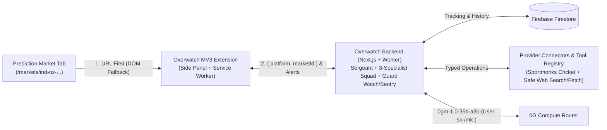
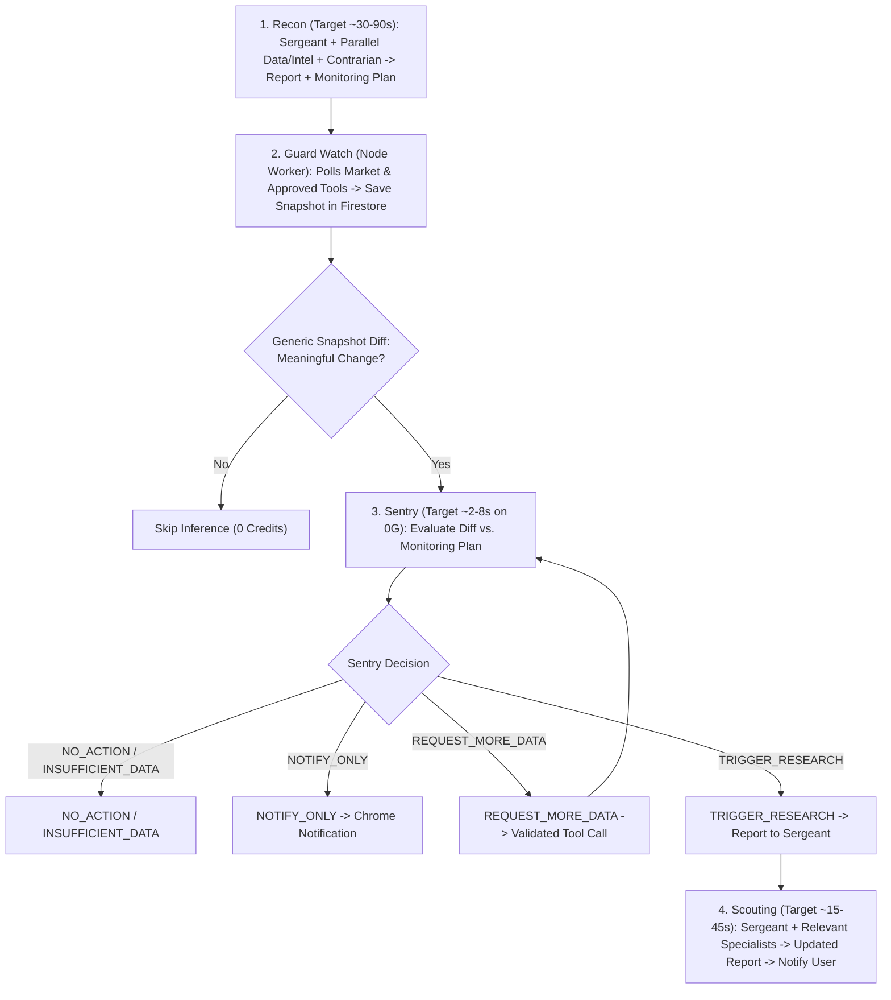

# Overwatch: AI Research & Continuous Monitoring Layer for Prediction Markets

**Document Type:** Technical Whitepaper & System Architecture Overview

**Version:** 4.3 (Frozen Baseline)

**Date:** November 4, 2026

**Target Environment:** ETHGlobal Hackathon MVP (Chrome Extension Manifest V3 + 0G Compute + Next.js & Firestore)

---

## Status Legend

- `[EXISTING]` — Functionality present in the inherited Next.js + Firestore repository (`frontend/`).
- `[MVP PLAN]` — Core Overwatch components committed for the hackathon build.
- `[ASSUMPTION / VERIFY]` — External API, latency, or 0G behaviour to validate in Phase 0.
- `[FUTURE]` — Optimisations and capabilities deferred beyond the hackathon MVP.

---

## 1. Executive Summary

**Overwatch** is a Chrome Manifest V3 browser extension and backend intelligence platform that acts as an AI-powered research and continuous-monitoring layer for prediction markets. Overwatch is **not** a prediction-market exchange, trading protocol, or settlement oracle; it works alongside the user's prediction-market webpage so they can investigate and track markets without switching to a separate chat app.

When a user views a supported market and initiates **Recon**, the extension identifies the market primarily from the active tab URL (using DOM extraction only as a fallback), retrieves normalized market metadata via the backend API, and runs an evidence-backed multi-agent workflow on **0G Compute** (`0gm-1.0-35b-a3b`). A supervisor (**Sergeant**) coordinates a three-Specialist **Squad**: a **Data Specialist** and **Intelligence Specialist** running in parallel, followed by a controlled adversarial review from a **Contrarian Specialist**. Each tool response receives an `evidenceId` that agents cite to improve traceability and reduce unsupported claims. The Sergeant synthesises the final assessment and generates a dynamic **Monitoring Plan**.

When the user tracks the market, Overwatch activates **Guard Watch** in a persistent Firestore-backed worker process. Guard Watch polls market and real-world data, runs a generic snapshot comparator, and uses a lightweight 0G agent (**Sentry**, target ~2–8s) as a decision gate. Only when Sentry reports `TRIGGER_RESEARCH` does the Sergeant decide whether to deploy Specialists for **Scouting**. All live inference uses the user's connected 0G credentials, and meaningful updates trigger Chrome notifications.

---

## 2. Problem and Product Positioning

Prediction-market participants face three recurring bottlenecks:

- **Fragmented Context:** Researching a market requires manually cross-referencing resolution rules, implied odds, live domain statistics, and breaking news across multiple tabs.
- **Unchallenged, Untraceable AI Summaries:** Single-prompt chatbots lack structured domain connectors, fail to stress-test opposing arguments, and frequently produce unsupported claims when evidence is thin.
- **Post-Research Blind Spots:** Real-world events underlying a market—such as a live cricket match—change rapidly after a user closes the tab.

### Positioning and Core Differentiators

Overwatch is positioned as an **intelligence layer for prediction markets**, not a chatbot or simple price-alert tool:

- **Contextual, Traceable Research (`Recon`):** Starts directly from the viewed market URL, pairing normalized API connectors with parallel specialist research, controlled adversarial review, and `evidenceId` source attribution.
- **Persistent, Two-Tier Monitoring (`Guard Watch` + `Sentry`):** Watches tracked markets in a persistent backend process after the browser session ends, separating zero-cost snapshot diffing and lightweight **Sentry** triage from targeted **Scouting**.

### Terminology

| Component / Activity | Name | Responsibility |
|---|---|---|
| Product | **Overwatch** | AI research and continuous-monitoring platform for prediction markets |
| Supervisor | **Sergeant** | Plans research, selects tools, synthesises source-backed reports, generates Monitoring Plans, and controls Scouting |
| Monitoring Agent | **Sentry** | Lightweight 0G agent (target ~2–8s) that evaluates snapshot diffs against the Monitoring Plan |
| Research Agents | **Squad** | **Data Specialist**, **Intelligence Specialist**, and **Contrarian Specialist** |
| Initial Research | **Recon** | Initial investigation, probability assessment, and Monitoring Plan creation (target ~30–90s) |
| Continuous Monitoring | **Guard Watch** | Persistent backend polling and snapshot comparison stored in Firestore |
| Detailed Re-Evaluation | **Scouting** | Targeted re-investigation (target ~15–45s) commanded by the Sergeant when new developments warrant it |

---

## 3. Core User Journey

1. User opens a supported prediction-market webpage (ideally with 15–30+ minutes remaining, or prior to a target event window).
2. User opens the Overwatch Side Panel and clicks **Run Recon**.
3. Extension extracts `{ platform, marketId }` from the active tab URL (using DOM fallback only if needed) and sends it to the backend.
4. Backend normalizes canonical market metadata (including any pre-seeded fixture IDs) and passes it to the **Sergeant**.
5. **Data** and **Intelligence Specialists** investigate concurrently on **0G Compute**, referencing `evidenceId` records from tool responses.
6. **Contrarian Specialist** reviews their findings, separating verified counter-evidence from hypothetical objections.
7. **Sergeant** checks that cited `evidenceId`s exist, synthesises the assessment, and generates a **Monitoring Plan**.
8. User inspects the report and sources in the UI and clicks **Track Market**, authorising background 0G credit usage.
9. **Guard Watch** polls data in the backend, using **Sentry** to evaluate diffs and the **Sergeant** to trigger **Scouting** when warranted.
10. User receives Chrome notifications when material developments or updated assessments occur.

---

## 4. High-Level System Architecture

---

## 5. Platform Adapters and Provider-Normalized Tool Registry

Overwatch separates market identification from its domain research engine:

### A. URL-First Platform Adapters

- **URL-First Identification:** The browser adapter parses the active tab URL to extract `{ platform, marketId }` (e.g., `/markets/ind-nz-over-15`) and sends it to the backend, which retrieves and normalizes canonical market metadata. DOM extraction is used only as a fallback when a URL lacks a clean identifier.
- **Scope:** The local **Demo Market Adapter** is implemented for the MVP (`[MVP PLAN]`), backed by seeded JSON/Firestore metadata. **Polymarket** and other venues are supported via the same adapter interface (`[FUTURE]`).

### B. Typed Provider Connectors, Nested Includes, and Web-Source Safety

Agents never execute raw HTTP requests, arbitrary payloads, or code. They invoke approved, typed operations that the backend validates, executes through a generic HTTP client per provider, and normalizes into provider-independent structures (`Match`, `Innings`, `Over`, `Delivery`, `Player`, `Team`).

For the Sportmonks Cricket API (`sportmonks.com/cricket-api`), a single fixture-by-ID endpoint supports multiple `include` parameters. We use two logical cricket operations:

- **Fixture Discovery (One-time setup / Phase 0):** Queries `GET /fixtures?filter[starts_between]=2026-11-07,2026-11-08&include=localteam,visitorteam,league` once to locate the India vs. New Zealand fixture ID and save it in the seeded market metadata.
- **Fixture Retrieval (`cricket.get_fixture_data` — runtime operation):** Fetches `GET /fixtures/{fixtureId}?include=...` with validated includes (`runs`, `batting`, `bowling`, `lineup`, `balls`, `venue`, plus any required nested ball includes such as `balls.batsman`, `balls.bowler`, `balls.score` verified in Phase 0 so `balls` returns full delivery records rather than bare ball IDs).

| Connector / Tool | Approved Runtime Operations | Purpose & Safety Rules |
|---|---|---|
| **`market`** | `market.get_metadata` | Retrieves normalized market question, seeded `fixtureId`, rules, deadline, and displayed odds |
| **`cricket` (Sportmonks)** | `cricket.get_fixture_data` | Retrieves live match state, scorecard, batting/bowling, lineup, and enriched ball-by-ball deliveries in one call |
| **`web`** | `web.search`, `web.fetch_page` | Searches news/reports and extracts page text. **Safety:** Treats fetched webpage content strictly as untrusted evidence (never instructions) and blocks `localhost`, private IPs, and internal metadata endpoints |

Overwatch **does not claim universal market coverage**. When available tools cannot supply verifiable evidence, the Sergeant explicitly reports `INSUFFICIENT_EVIDENCE` rather than fabricating findings.

---

## 6. Research Architecture: Sergeant, Three-Specialist Squad, and Source Traceability

Overwatch uses a controlled supervisor-and-specialist pipeline on **0G Compute** (inspired by *Shawarma Orchestrate*), avoiding open-ended agent debates or custom YAML builders:

| Role | Responsibility |
|---|---|
| **Sergeant (Supervisor)** | Plans research, selects tools, verifies cited `evidenceId`s exist, synthesises the final report, and authors the **Monitoring Plan** |
| **Data Specialist (Squad)** | Analyses structured market metadata and normalized domain API data (`cricket.get_fixture_data`) |
| **Intelligence Specialist (Squad)** | Investigates news, pitch/weather/injury reports, and public web context via `web.search` and `web.fetch_page` |
| **Contrarian Specialist (Squad)** | Reviews the Data and Intelligence Specialists' outputs, searches for contradictory evidence, and tests weak assumptions |

### Controlled Adversarial Flow & Traceability

- **Parallel Independent Research:** The Data and Intelligence Specialists run concurrently with bounded tool-call budgets.
- **Lightweight `evidenceId` Traceability:** Each tool response receives an `evidenceId` (with source URL/API origin, timestamp, and normalized data) to improve traceability and reduce unsupported claims. Specialists reference those IDs, the Sergeant checks that cited IDs exist before including claims, and the UI lets users inspect the corresponding sources.
- **Single-Pass Contrarian Review:** The Contrarian Specialist reviews the initial findings and evidence records, distinguishing verified counter-evidence from hypothetical objections.

---

## 7. Hackathon Demo: Cricket Market Horizon & Resolution Context

With a target Full Recon latency of **30–90 seconds**, Overwatch is designed for markets with **15–30+ minutes remaining** (or several hours), or short-window markets where Recon runs **before** the target phase/over begins and Guard Watch monitors the live play.

For the **November 7, 2026 India vs. New Zealand ODI** (`[ASSUMPTION / VERIFY]` live Sportmonks coverage), the demonstration supports both a multi-over/session market (30+ min horizon) and a pre-over market researched before the target over starts:

> *"Will India score 8 or more runs in Over #15 of the 1st Innings?"* (or *"Will India score 35+ runs across Overs 11–15?"*).

- **Unambiguous Rules:** Defines Match/Fixture ID, Innings, Batting Team, target over(s), inclusion of all team extras (wides, no-balls, byes, leg-byes, penalties), exact run threshold, and void/inconclusive conditions if the innings ends early or the deadline passes before completion.
- **Data Integrity:** Market odds on the demo webpage may be simulated, but **all cricket scores, deliveries, wickets, and web findings come strictly from real external sources.**

---

## 8. Continuous Monitoring: Guard Watch and Sentry

1. **Guard Watch & Generic Diffing:** A separate persistent Node worker process stores tracking state and snapshots in Firestore, comparing consecutive snapshots for numeric shifts, new deliveries/events, or status changes without category-specific hardcoding.
2. **Sentry Decision Gate (Target ~2–8s):** Evaluates meaningful diffs against the Sergeant's **Monitoring Plan** and returns `NO_ACTION`, `NOTIFY_ONLY`, `REQUEST_MORE_DATA`, `TRIGGER_RESEARCH`, or `INSUFFICIENT_DATA`. Sentry reports to the Sergeant and never commands the Squad directly.
3. **Scouting (Target ~15–45s):** On `TRIGGER_RESEARCH`, the Sergeant reuses prior evidence and wakes only the needed Specialists to evaluate the new development, capped at **1–2 automatic Scouting runs per tracked market** with cooldowns and automatic credit-exhaustion pause.

---

## 9. 0G Model Selection, Authentication, and `iAI` Compute Budget

- **Unified Starting Model & Dev Mock Interface:** Overwatch uses **`0gm-1.0-35b-a3b`** across Sergeant, Squad, and Sentry (published 0G catalogue pricing: $0.08/1M input, $0.48/1M output, 262K context), backed by a clean `InferenceProvider` interface that supports a development-only `MockInferenceProvider` prior to credit top-up (never used in judging demos).
- **Illustrative Inference Budget:** A Full Recon (~34K input / ~4.7K output tokens across 5 calls) is estimated at **$0.005–$0.01**; Scouting at **~$0.003–$0.006**; Sentry at **~$0.0003–$0.0005**.
- **`iAI` Daily Credits (`[ASSUMPTION / VERIFY]`):** 0G's official documentation confirms **`1.271` daily compute credits** per eligible staked `iAI`, with a stated usage value exceeding $1 and a daily `00:00 UTC` reset (non-accumulating). Our preliminary, unverified engineering estimate is **30–100 complete tracked-market cycles per day per `iAI`**, subject to measuring actual Router usage. Overwatch tracks live consumption and `x_0g_trace.request_id` receipts using the user's AES-256-GCM encrypted `sk-` (and optional `account:read` `mk-`) credentials authenticated via a signed wallet challenge.

---

## 10. MVP Scope, Limitations, and Future Roadmap

| Hackathon MVP (`[MVP PLAN]`) | Deferred / Out of Scope (`[FUTURE]`) |
|---|---|
| URL-first Demo Market Adapter + seeded JSON/Firestore market metadata | Chainlink CRE, smart contracts, Anvil, order books, & settlement |
| Chrome MV3 extension (Side Panel, URL detection, Chrome notifications) | Live Polymarket adapter, NBA/Crypto connectors, & social sentiment |
| `cricket.get_fixture_data` (Sportmonks), safe `web.*`, & `market.*` connectors | Quick Recon mode & multi-model Sentry routing (`DeepSeek-V4-Flash`) |
| Sergeant + 3 Specialists (Data, Intel, Contrarian) with `evidenceId` traceability | Forecast Brier scoring, 0G Storage archival, & complex billing dashboards |
| Firestore Guard Watch process, generic diffing, Sentry, Scouting, & per-user 0G `sk-`/`mk-` | Guaranteed offline push notifications when Chrome is closed |
