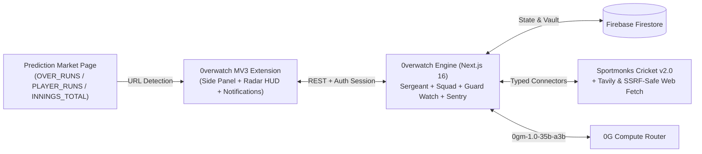

# 0verwatch: Autonomous Multi-Agent Intelligence & Risk Layer for Prediction Markets

**Version:** 1.0 (Final Protocol Release)  
**Runtime Stack:** Chrome Extension (Manifest V3) • Next.js 16 • Firebase Firestore • 0G Compute Network (`0gm-1.0-35b-a3b`)

---

## 1. Executive Summary

**0verwatch** is a browser-native multi-agent research and autonomous risk-monitoring protocol for prediction markets, built on **0G Compute**. Operating via a Chrome Manifest V3 Side Panel alongside prediction market pages, 0verwatch eliminates two fundamental bottlenecks faced by market participants:

1. **Fragmented, Unverified Pre-Trade Research:** Market participants must manually cross-reference resolution criteria, live match telemetry, and breaking news across disparate sources, while standard single-prompt AI assistants hallucinate statistics and fail to stress-test opposing theses.
2. **Post-Entry Blind Spots:** Real-world sporting events evolve rapidly after a trader takes a position and leaves the tab, exposing open positions to sudden match shocks (wickets, rain delays, injury withdrawals, or run-rate collapses).

0verwatch solves both through two tightly coupled subsystems: **Recon** (a supervisor-led 4-agent research pipeline with cryptographic `EV-XX` source attribution) and **Guard Watch + Sentry** (a persistent background monitoring engine capable of autonomous protective stop-loss liquidation and real-time browser alerts).

---

## 2. System Architecture

### Core Protocol Roles

| Agent / Engine | Responsibility |
|---|---|
| **Sergeant (Supervisor)** | Deconstructs market resolution criteria, dispatches parallel specialists, enforces `EV-XX` evidence citation integrity, synthesizes probability assessments (`YES` / `NO` / `INCONCLUSIVE`), and authors the **Monitoring Plan**. |
| **Data Specialist** | Queries normalized live match scorecards, batting/bowling splits, run rates, and ball-by-ball telemetry via the Sportmonks Cricket API v2.0 connector. |
| **Intelligence Specialist** | Executes targeted real-time web searches and SSRF-guarded article extractions for pitch reports, weather conditions, playing XI news, and matchup history. |
| **Contrarian Specialist** | Conducts adversarial review over Data and Intelligence findings, separating verified counter-evidence from speculation to expose thesis vulnerabilities. |
| **Guard Watch** | In-process 20-second scheduler and standalone worker that polls live match state in memory and runs a deterministic snapshot comparator at zero inference cost when state is unchanged. |
| **Sentry (Risk & Stop-Loss Agent)** | Triggered on material state transitions or position discrepancies; evaluates live Sportmonks telemetry and breaking web news against the user's open paper position to issue alerts, escalate to **Scouting**, or autonomously liquidate at-risk positions (`CLOSE_POSITION`). |

---

## 3. Multi-Agent Recon & Verifiable Evidence Traceability

When a user opens a market and triggers **Recon**, 0verwatch extracts the canonical market identifier from the active URL and initiates a four-stage pipeline on **0G Compute** while rendering real-time progress on an animated SVG **Recon Radar HUD**:

1. **Supervisor Planning:** The Sergeant inspects the market question, target window, and IST (`+05:30`) match schedule to assign bounded tool-call budgets to the Squad.
2. **Concurrent Specialist Execution:** The **Data Specialist** (`cricket.get_fixture_data`, `market.get_metadata`) and **Intelligence Specialist** (`web.search`, `web.fetch_page`) execute in parallel. Every tool output is normalized and assigned a sequential immutable identifier (`EV-01`, `EV-02`, ...) by the `EvidenceCollector`.
3. **Adversarial Stress-Testing:** The **Contrarian Specialist** audits the collected evidence pool to challenge consensus assumptions and identify edge-case void or loss conditions.
4. **Deterministic Claim Verification & Synthesis:** Before publishing the final report, the backend runs `verifyAndSanitizeClaims` to strip any citation that does not map to a verified `EV-XX` record, preventing hallucinated sources. The Sergeant outputs a calibrated probability assessment and a tailored **Monitoring Plan**.

---

## 4. Guard Watch, Autonomous Sentry Stop-Loss & Scouting

Once a user enters a paper position (`YES` or `NO`) and enables **Guard Watch**, 0verwatch transitions from research to active position defense:

- **Zero-Waste Snapshot Diffing:** The in-memory `GuardWatchRegistry` polls live match telemetry every 20 seconds without redundant database reads. If no meaningful change has occurred in score, wickets, overs, or match status, zero 0G inference tokens are consumed.
- **Autonomous Sentry Evaluation:** When the `SnapshotComparator` detects a material match shift, **Sentry** evaluates the delta alongside live Sportmonks statistics and fresh web intelligence relative to the user's held side:
  - **`NO_ACTION` / `NOTIFY_ONLY`:** Logs routine progress or dispatches a Chrome MV3 desktop notification.
  - **`TRIGGER_RESEARCH` (Scouting):** Escalates to the Sergeant to re-deploy Specialists for an updated probability report.
  - **Autonomous Stop-Loss (`CLOSE_POSITION`):** If a severe real-world shock (e.g., key batter dismissal, sudden collapse, or adverse weather intervention) invalidates the user's position thesis, Sentry autonomously closes the open paper position to preserve capital and dispatches a high-priority stop-loss notification (capped at 3 notifications spaced at 30-second intervals).

---

## 5. Decentralized 0G Compute & Cryptographic Security

- **Verifiable 0G Inference:** All agent completions execute via the 0G Compute Network (`0gm-1.0-35b-a3b` with automatic multi-node retry and model fallback), capturing `x_0g_trace` request receipts and live token telemetry on every run.
- **Wallet Challenge Auth & AES-256-GCM Vault:** Users authenticate via EVM cryptographic signature verification (`viem`). User-supplied 0G `sk-` and `mk-` keys are encrypted at rest using **AES-256-GCM** with per-record initialization vectors and authentication tags, paired with live 0G balance inspection and daily compute budget guards.
- **SSRF & Prompt-Injection Defense:** Agents only invoke schema-validated tools. Web fetches resolve DNS prior to connection to block loopback, private RFC1918, and cloud metadata IPs, and wrap extracted text in `<UNTRUSTED_WEB_EVIDENCE>` delimiters.
